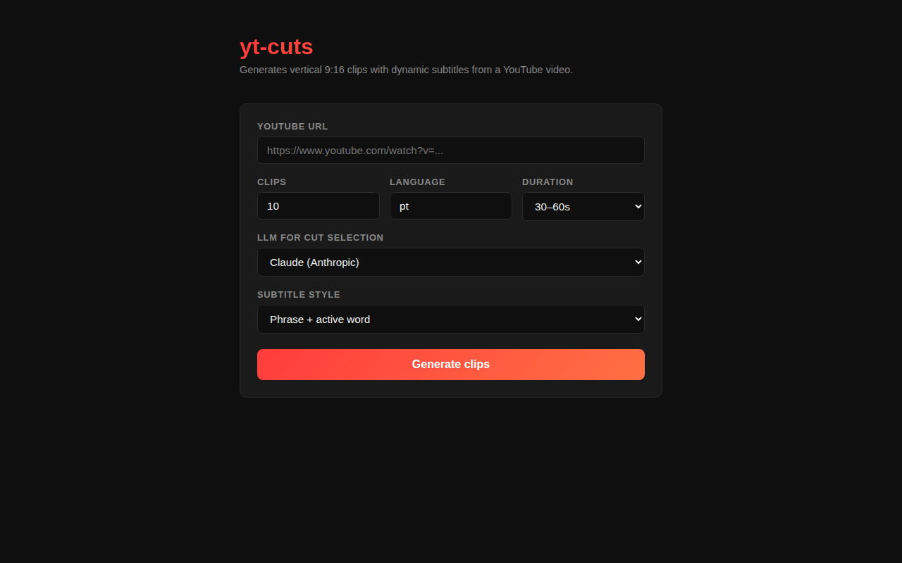

# yt-cuts

Turn a long YouTube video into short vertical (9:16) clips with animated, word-by-word subtitles — ready for TikTok, Reels and Shorts.



## How it works

1. **Download** — fetches the video with `yt-dlp` and extracts the audio.
2. **Transcribe** — sends the audio to Deepgram (`nova-3`) for a transcript with per-word timestamps and speaker labels.
3. **Pick the cuts** — an LLM (Claude or GPT) reads the transcript and chooses the most engaging segments within the target duration; boundaries are snapped to word edges.
4. **Reframe** — crops each segment to 9:16 (static center crop).
5. **Subtitle & render** — builds an `.ass` subtitle file with TikTok-style animations and burns it into the clip with FFmpeg.

Downloads and transcripts are cached in `./.cache`, so re-running on the same video doesn't pay for ASR again.

## Requirements

- Python 3.12+
- FFmpeg on your `PATH`
- A [Deepgram](https://deepgram.com) API key
- An [Anthropic](https://console.anthropic.com) **or** [OpenAI](https://platform.openai.com) API key

## Setup

```bash
python -m venv .venv && source .venv/bin/activate
pip install -r requirements.txt
pip install openai                    # only if you use GPT for cut selection
pip install -r requirements-web.txt   # only for the web UI

cp .env.example .env                  # then fill in your keys
```

`.env`:

```ini
DEEPGRAM_API_KEY=...
ANTHROPIC_API_KEY=...
OPENAI_API_KEY=...
# LLM_PROVIDER=claude   # or "openai"; auto-detected from the key you set
```

## Usage

### Command line

```bash
python cut.py "https://www.youtube.com/watch?v=..." --clips 5 --language en --style word-bounce
```

| Option | Default | Description |
|---|---|---|
| `--clips` | `10` | Number of clips to generate |
| `--language` | `pt` | Spoken language of the video |
| `--style` | `phrase-pop-highlight` | Subtitle style (see below) |
| `--min-dur` / `--max-dur` | `20` / `60` | Clip duration range, in seconds |
| `--llm` | `claude` | `claude` or `openai` |
| `--out` | `./output` | Output folder |
| `--no-cache` | off | Ignore cached downloads/transcripts |

Clips are written as `output/clip_01.mp4`, `clip_02.mp4`, …

### Web UI

```bash
uvicorn web.server:app --reload
```

Open <http://localhost:8000>, paste a URL, pick the options and click **Generate clips**. When the job finishes, the page lists the clips with download links.

## Subtitle styles

| Style | Look |
|---|---|
| `phrase-pop-highlight` | The phrase pops in and the word being spoken is highlighted |
| `phrase-pop` | The phrase pops in, no per-word highlight |
| `word-bounce` | Each word bounces in as it's spoken |

## Project layout

```
cut.py              CLI entry point
yt_cuts/
  download.py       yt-dlp download
  audio.py          audio extraction
  asr/              speech-to-text (Deepgram)
  cuts/             LLM cut selection + post-processing
  reframe/          9:16 cropping
  subtitles/        .ass builder and style presets
  render.py         FFmpeg rendering
  pipeline.py       glues the steps together
web/                FastAPI server + single-page UI
tests/              pytest suite
```

## Tests

```bash
pytest
```

The tests mock all external APIs, so they cost nothing to run.
